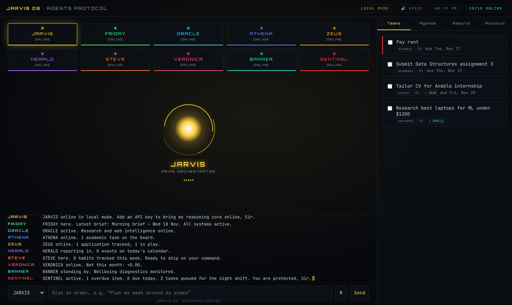

# JARVIS OS

A personal multi-agent system powered by Claude. JARVIS runs your personal life, career and academics as a
team of 10 AI agents. They take orders by voice or text, work through queued tasks overnight while you sleep,
and send you daily reports.



## The team

| Agent | Role | What it does |
|---|---|---|
| **JARVIS** | Prime Orchestrator | Takes your orders, keeps tasks, calendar and goals in order, and delegates to the specialists |
| **FRIDAY** | Daily Intelligence | Morning brief, evening report, weekly review |
| **ORACLE** | Research | Web research, comparisons, decisions, saved as notes |
| **ATHENA** | Academics | Assignments, exam prep, study plans, revision blocks, study material |
| **ZEUS** | Career | Job and internship pipeline, CV and cover-letter drafts, interview prep |
| **HERALD** | Comms & Meetings | Meeting notes → action items, email and message drafts |
| **STEVE** | Fitness & Habits | Workouts, routines, habit tracking |
| **VERONICA** | Finance | Spending log, budgets, savings |
| **BANNER** | Wellbeing | Sleep, stress and burnout watch |
| **SENTINEL** | Deadline Watch | Scans every few hours for overdue or at-risk work and raises alerts |

## Autopilot (what runs while you rest)

| When | Who | Job |
|---|---|---|
| 07:00 daily | FRIDAY | **Morning brief**: schedule, top 3 priorities, deadlines, overnight results |
| Every 3 h | SENTINEL | **Deadline watch**: fixes what it can and alerts you only when needed |
| 21:00 daily | FRIDAY | **Evening report**: what got done, what slipped, plan for tomorrow |
| 02:00 daily | JARVIS | **Night shift**: every task with an agent assignee gets done autonomously |
| Sun 18:00 | JARVIS | **Weekly review** across life, career and academics |

All times can be changed in `.env`. Reports show up in the dashboard and, if you set them up, arrive by
**e-mail** and/or **Telegram**.

To queue work for the night, just say it, e.g. *"Oracle, research the best laptops for ML under $1200 tonight"*
or *"Athena, make me a 2-week revision plan for my calculus exam on Dec 3"*. JARVIS creates the task, assigns it
to the right agent, and the result is in your morning brief.

## Quick start

1. Get an API key at <https://console.anthropic.com>.
2. Run:
   ```bash
   ./start.sh          # macOS / Linux
   start.bat           # Windows
   ```
   The first run creates `.env` and `profile.md`. Put your `ANTHROPIC_API_KEY` in `.env`, set your name and timezone,
   then run it again.
3. Fill in `profile.md` (your courses, career goals, habits, routine). Every agent reads it.
4. The command centre opens at <http://127.0.0.1:7334/command-centre.html?autostart=true>. Click **Engage Protocol**
   and the agents report in.

Keep the program running for the autopilot to work. On a laptop, leave it plugged in with sleep turned off,
or run it on a small always-on machine or VPS.

### Terminal use
```bash
python -m jarvis ask "What's on my plate this week?"
python -m jarvis ask --agent ZEUS "Find 5 remote junior backend roles and track them"
python -m jarvis job morning_brief       # run any routine now
python -m jarvis agents
```

## Safety limits

Agents only change your own JARVIS records (tasks, calendar, notes, goals, money log) and send reports to you.
They never contact other people, buy anything, move money or submit applications. They write drafts and create
a task for you to act on. Your data stays in `data/jarvis.db` on your machine.

## Layout

```
jarvis/
  agents.py     the agent roster (roles, colours, tools, effort)
  engine.py     Claude tool-use loop, delegation, chat memory
  tools.py      everything agents can do (tasks, calendar, notes, goals, habits, career, money, reports)
  scheduler.py  autopilot: briefs, reports, watchdog, night shift
  server.py     API + live event stream for the dashboard
  store.py      SQLite storage
  notify.py     e-mail / Telegram delivery
web/command-centre.html   the HUD dashboard (voice in/out, live agent activity)
tests/                    offline tests (pytest)
```
